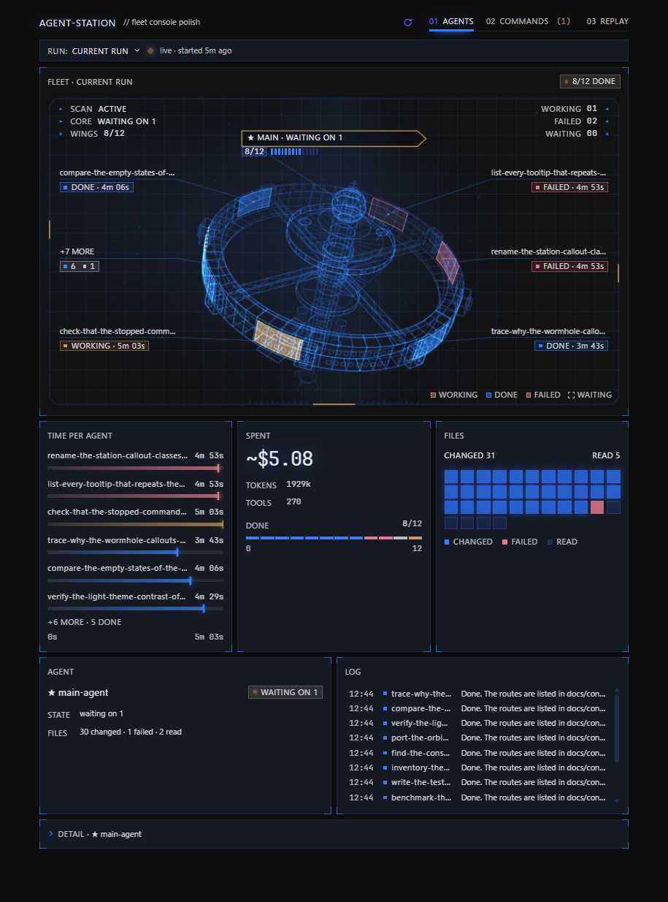
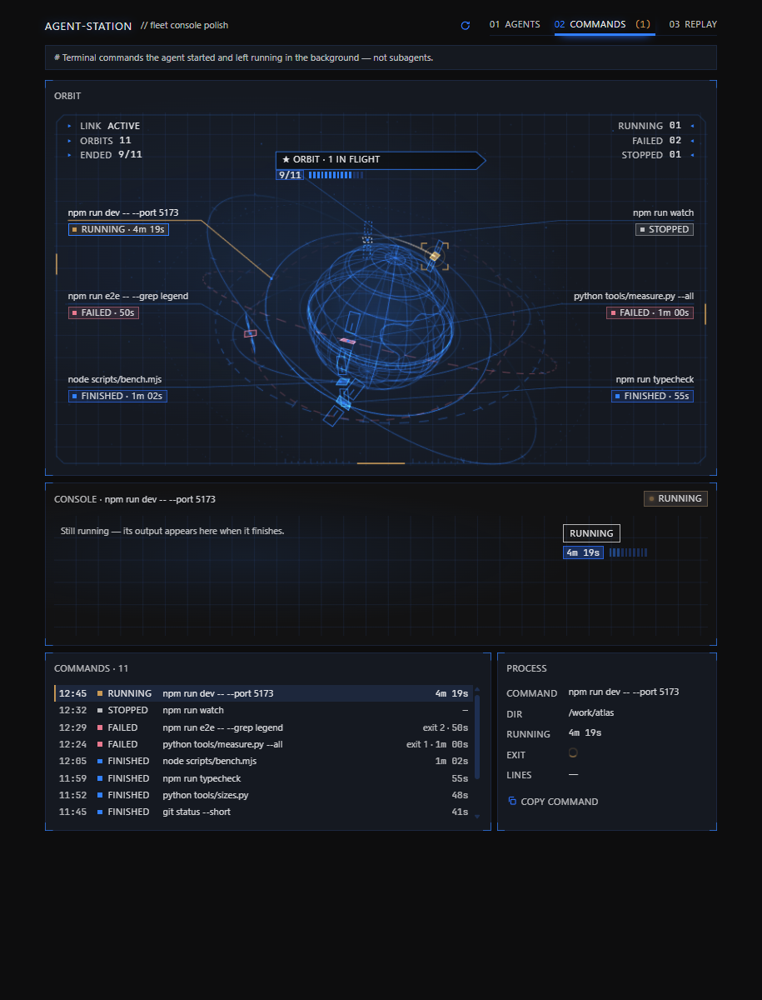
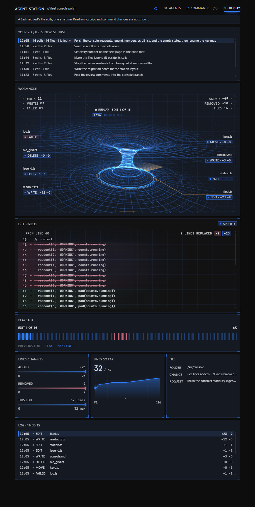

# Agent Station

A Hermes Desktop plugin that shows what the AI in your focused chat is doing. One page shows the main
agent and the subagents it started (`delegate_task`), drawn live as a wireframe space station: what
each one works on, the files it changed, its answer and its cost. A Commands tab lists the chat's
background shell commands, and a Replay tab steps through every file edit the AI made after each of
your requests. A status-bar chip shows the running batch's progress while the page is closed.
Everything is read-only.

## Screenshots

Drawn from synthetic test data (the fixture home of `tests/live.py`), in the real app engine.







## Supported Hermes versions

Requires Hermes 0.21.7 or newer, tested up to 0.22.2. Your Hermes version is in Settings → About
(or run `hermes --version`). An older Hermes refuses to load the plugin's agent half and says
"requires hermes >=0.21.7".

## Install

In the Hermes app:

1. Open Settings → Capabilities → Plugins → **Install from Git**.
2. Paste this repository's web address (the page you are reading) into "Repository".
3. Click **Review repository**.
4. Leave "Enable agent plugin after install" on, then install.
5. "Agent Station" appears in the sidebar.

Hermes copies the desktop page into place by itself; there is nothing to copy by hand.

From a terminal instead:

```bash
hermes plugins install <repository URL> --enable
```

## Update

Install from Git again with the same address and tick "Force reinstall (replace if already
installed)", or run:

```bash
hermes plugins update agent-station
```

## Uninstall

Settings → Capabilities → Plugins → the Agent Station row → **Uninstall**, or:

```bash
hermes plugins remove agent-station
```

## Moving from Subagent Watch

Agent Station is the new name of Subagent Watch. Remove the old plugin first: Plugins → Uninstall
"subagent-watch", or `hermes plugins remove subagent-watch`. If a "Subagents" entry is still in the
sidebar afterwards, uninstall the remaining Desktop row or delete
`<Hermes home>/desktop-plugins/subagent-watch`. Then install Agent Station. Keeping both shows two
sidebar entries and two status-bar chips. There are no settings to carry over.

## Privacy

- **Read-only.** The backend opens Hermes' `state.db` with SQLite `mode=ro`, so it cannot write, and
  it registers GET routes only. The static audit (`tests/audit_static.py`) fails if a writing route
  or a file write ever appears.
- **Local only.** The page talks only to your own Hermes. It makes no other network calls and sends
  no telemetry.
- **One chat at a time.** The page reads one chat at a time; a request for a worker, command or
  edit that belongs to another chat is refused (403).

## Troubleshooting

- **No "Agent Station" in the sidebar.** Turn on the plugin row's **Desktop** switch, click Rescan,
  or restart Hermes (pages register when the app starts).
- **The page says something "could not be read".** Turn on the row's **Agent** switch (the backend
  only runs for enabled plugins), then restart Hermes.
- **Two entries in the sidebar, or two progress chips.** The plugin's old version is still
  installed under its old name; remove it as the moving section above says.
- **"requires hermes >=0.21.7".** Your Hermes is older than the oldest supported version; update
  Hermes.

## For developers

Read `AGENTS.md` (the rules for changing this repository, setup and the gate order) and
`Docs/agent-station-notes.md` (where every number on the page comes from and why each status rule
is what it is) before changing anything.

### Backend routes

Mounted at `/api/plugins/agent-station/`: `GET /children` · `GET /output` · `GET /processes` ·
`GET /process_output` · `GET /files` · `GET /replay` · `GET /replay_step` — all read-only.

`state.db` is opened with `mode=ro`; the process list reads the files Hermes writes itself
(`processes.json`, `logs/process-results/`). A session or process that belongs to another chat is
refused with 403.

### Gates

Run from `tests/` after `npm ci`. What each lock asserts is in the header of its file.

```bash
python check_api.py                 # backend against a fixture state.db   (--live: this home's too)
node render_check.mjs               # jsdom + real React, driven like a user
python audit_static.py              # i18n, a11y, colours, silent catches, read-only backend, release, name, licence, privacy
python contract_core.py             # everything read from the core still exists (--selftest)
python release_gate.py              # version / changelog / supported range / installed copy rules each fire
python canary_audit.py              # every mutation must turn its gate red
python live.py                      # the real panel in the core's Electron on fixture data (--selftest)
```

A rule that has never failed is not evidence: `canary_audit.py`, `release_gate.py`,
`contract_core.py --selftest` and `live.py --selftest` break every rule once and require the gate
to name it.

### Portability

| Variable | Default | What it points at |
|---|---|---|
| `HERMES_HOME` | `%LOCALAPPDATA%\hermes`, else `~/.hermes` | the install root (state.db, the installed desktop copy) |
| `HERMES_AGENT_DIR` | `<HERMES_HOME>/hermes-agent` when present | the core checkout — contract sources, compiled stylesheet |
| `HERMES_PYTHON` | the core's venv, else the running interpreter | the interpreter with fastapi for `check_api.py` |
| `HERMES_ELECTRON` | the core's `apps/desktop/node_modules/electron` | the binary for the measured render |

`python env.py` prints what a run resolved. A missing core is named (`no Hermes core found`), never
silently passed.

### Continuous integration

- `.github/workflows/ci.yml` runs the backend check, the static audit, the core contract (and its
  selftest), the release gate, the jsdom render check and the canary run on Ubuntu and Windows,
  against a sparse checkout of the oldest supported core, pinned at `CORE_SHA` (v0.21.7). It runs once
  per pull request (a newer commit cancels the older run) and on every push to `main`; Actions → CI →
  "Run workflow" runs it by hand.
- `.github/workflows/newest-core.yml` runs the backend check, the render check and the core contract
  (and its selftest) every week against the newest core: the latest Hermes release and the head of
  `main`. It also runs by hand from the Actions tab.
- `live.py` needs the core's built desktop app, its Electron and a display, so it stays local: run it
  before a release.

`main` has no GitHub-enforced protection, so the rule lives in `AGENTS.md`: every change reaches
`main` through a pull request whose CI is green.

### Versioning

`plugin.yaml` is the source; bump `plugin.yaml`, `dashboard/manifest.json` and the top
`CHANGELOG.md` heading together (the release gate checks them). When the oldest supported Hermes
moves, bump `requires_hermes` in `plugin.yaml`, the range under "Supported Hermes versions" above and
`CORE_SHA` in `ci.yml` together. Release checklist: bump, run every gate (including `live.py`), then
tag.

## License

MIT — see [LICENSE](LICENSE). Copyright (c) 2026 Muhammed Enes Alpler.
